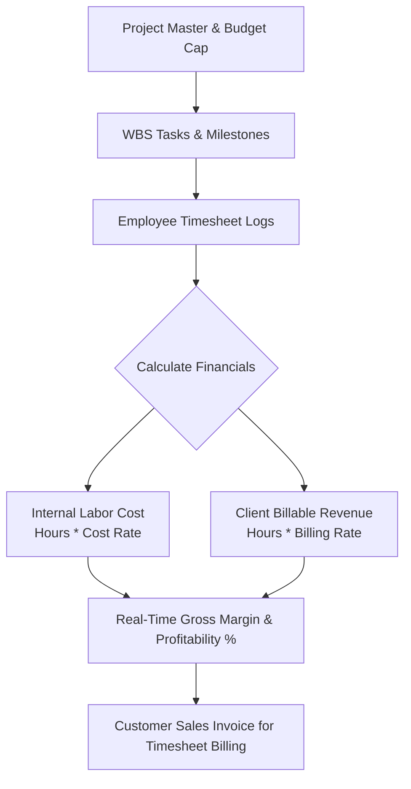

# ERPNext Projects & Timesheet Costing Engine (Tasks, Milestones & Costs)

[](https://www.python.org/)
[](https://frappe.io)
[](https://erpnext.com)
[](LICENSE)
[]()

> **"Tasks, milestones, timesheets aur project costs"**  
> Complete project portfolio management and professional services automation engine for Frappe & ERPNext covering Work Breakdown Structures (WBS), employee timesheet tracking, billable realization, and real-time profitability auditing.

---

## 🎯 The Real-World Client Problem & Business Context

Professional services firms, EPC contractors, and IT agencies frequently bleed margins:
1. **Unbilled Consultant Hours:** Developers and field consultants perform billable client work but fail to log timesheets promptly, leaving revenue uncollected.
2. **Scope Creep & Budget Overruns:** Projects run past their completion milestones without anyone noticing that internal labor costs have exceeded contract value.
3. **No Project Profitability Visibility:** Management only finds out if a project was profitable months after delivery when all accounts are settled.

**This engine solves these challenges:** It captures employee timesheet hours with dual costing (internal employee hourly cost vs client billing rate), calculates live project margins, and tracks milestone progress.

---

## 🏗️ Project Timesheet & Costing Workflow Flow



---

## ⚙️ Key Enterprise Features & Capabilities

- **Work Breakdown Structure (WBS):** Hierarchical project tasks, dependencies, milestone dates, and Gantt chart scheduling.
- **Activity-Based Timesheets:** Daily/weekly timesheet submission with activity types, project task links, and manager approval.
- **Dual-Rate Costing Engine:** Tracks both the internal payroll cost per hour and the contract billing rate to compute real-time project gross margin.
- **Automated Timesheet Invoicing:** Directly converts approved billable timesheet hours into ERPNext Sales Invoices.
- **Budget Variance Monitoring:** Compares actual hours and costs against estimated budgets with automated alerts upon exceeding 80% and 100% caps.

---

## 📂 Repository & Module Structure

```
erpnext-projects-timesheet-costing-engine/
├── projects_costing/
│   ├── __init__.py           # Package version & module exports
│   └── engine.py             # Project timesheet & gross margin profitability engine
├── tests/
│   ├── __init__.py
│   └── test_projects_costing.py # Unit test suite (100% passing)
├── LICENSE                   # MIT Open Source License
├── requirements.txt          # Python dependencies
└── README.md                 # Complete documentation
```

---

## 💻 Production Usage Example

```python
from projects_costing.engine import (
    ERPNextProjectsCostingEngine, ProjectTimesheet
)

engine = ERPNextProjectsCostingEngine()

# 1. Collate employee timesheets for an enterprise client engagement
timesheets = [
    ProjectTimesheet("TS-01", "EMP-LEAD", hours_worked=40.0, cost_rate_per_hour=750.0, billing_rate_per_hour=2500.0),
    ProjectTimesheet("TS-02", "EMP-DEV", hours_worked=80.0, cost_rate_per_hour=450.0, billing_rate_per_hour=1500.0)
]

# 2. Derive project profitability
profit = engine.calculate_project_profitability("PROJ-ERP-IMPLEMENTATION", timesheets)
print(f"Total Billable Hours: {profit.total_hours_logged} hrs")
print(f"Total Revenue:  Rs. {profit.total_billable_amount}")
print(f"Internal Cost:  Rs. {profit.total_internal_cost}")
print(f"Gross Margin:   Rs. {profit.gross_margin_amount} ({profit.gross_margin_pct}%)")
```

---

## 🧪 Testing & Verification

Run tests with standard Python:
```bash
python3 -m unittest discover tests
```

---

## 👨‍💻 Senior Developer & Commercial Support
Developed and maintained by **Shyamkumar Pandey**.  
For professional services automation, EPC project tracking, and ERPNext consulting:
- **GitHub:** [@shyampandey1104](https://github.com/shyampandey1104)
- **Email:** [shyampandey1104@gmail.com](mailto:shyampandey1104@gmail.com)
